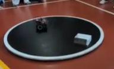
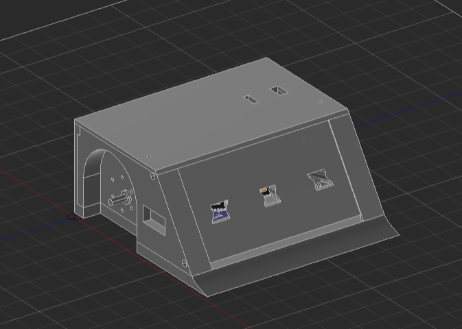

# Megasumo_V3

3 KG Megasumo robot built from scratch. It fits in a 20x20 cm bounding box and features a 3D-printed chassis designed from scratch.

## Hardware

- **ESP32:** Microcontroller and brain of the sumobot.
- **VL53L1X:** Front sensors. TOF-based laser sensors that detect distance.
- **SHARP IR:** Side sensors. IR-based sensors with a conic working envelope that return distance as analog readings.
- **QRE1113:** IR-based reflectance sensors on the bottom front corners, used to detect if the robot is about to exit the ring. They return digital values for black or white.
- **JGB37-545:** Mid-speed 12V DC motors that run at 150 rpm and produce 7.5 kg·cm of torque per motor.
- **PCBFun 60A Motor Driver:** Relatively new, and documentation may still be lacking. It is a dual-channel motor driver with a rated peak current of 60A and a 5V and GND pin to power the microcontroller.

## About The Robot

The sumobot was designed to compete in an open 3 kg category, with a maximum size of 20 cm x 20 cm. Its main functions on the ring are enemy detection using its 3 laser sensors to track and push out enemies. It also uses its bottom sensors to reverse when it detects white near the edges of the ring.

## Competition Result

During the competition, our team beat 2 other robots before being eliminated by a different sumobot. Building a robot from scratch and competing with it was very fun, and we learnt many new things about making a sumobot. The competition was full of high-speed builds that focused more on enemy detection and pushing than on ring detection, which made us rethink how we would build the next design for a different competition.

## Files

- Firmware: [SLU_SUMO.ino](firmware/SLU_SUMO.ino)
- CAD (STEP): [ASSEMBLY.step](3d_design/ASSEMBLY.step)
- CAD (STL): [ASSEMBLY.stl](3d_design/ASSEMBLY.stl)
